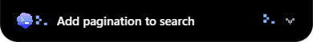
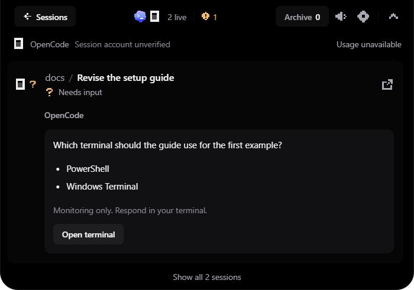
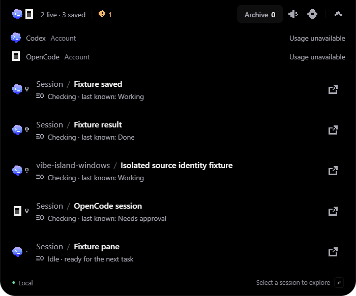

# Threadcap · Dynamic Island for Windows


> **Threadcap brings Codex CLI, Antigravity CLI, and OpenCode CLI into one island at the top of your screen.** See which agent is working, catch requests for input, and return to its terminal from your Windows desktop.


[Quick start](#quick-start) · [Roadmap](#roadmap) · [Releases](https://github.com/reshandytaftazani/Threadcap/releases) · [Windows builds](https://github.com/reshandytaftazani/Threadcap/actions/workflows/windows.yml) · [Documentation](docs/README.md)

---

## The problem

With several coding agents running in separate terminals, you have to switch windows to find out which one needs you.

- A request can sit unanswered in a background tab while you work in another project.
- A finished task can be hard to spot among terminals that are still working.
- After switching projects, you have to find the terminal that already has the context you need.

## The solution

Threadcap keeps session status in a compact strip attached to the upper edge of the display. Hover to reveal more in the strip, or open it to read session context and act on supported requests.

| What you can do | How it works |
| --- | --- |
| **Scan your sessions** | See activity across all three CLIs, with a provider icon and state indicator for each session. |
| **Catch requests** | Fresh questions and approval requests can open the island without taking focus from your current window. |
| **Return to a terminal** | Reopen a verified Orca pane or activate a linked PowerShell console or Windows Terminal target. |
| **Recover context** | Reopen Threadcap to see saved sessions. Confirmed closures move to Archive with their context and CLI history intact. |

## Preview

| Compact strip | Focused question | Session overview |
| :---: | :---: | :---: |
|  |  |  |
| Current task at the top edge | Question and next action in context | Activity across connected agents |

*Captured in the Windows app using sample sessions.*

## Development status

| Area | Status | Evidence |
| --- | --- | --- |
| **Windows desktop** | x64 preview | The NSIS installer and in-place upgrade were verified on Windows. Broader Windows and display-scaling coverage is pending. |
| **Provider setup** | Connect all | Batch registration was verified with Codex 0.169.0, Antigravity 1.5.10, and OpenCode 2.3.0 in isolated profiles. |
| **Live provider checks** | Verified by feature | An isolated OpenCode 2.3.0 server exercised questions and lifecycle events. Authenticated interactive verification for Antigravity 1.5.10 is pending. |
| **Distribution** | Private prerelease | The 0.8.4 Windows Preview includes the unsigned installer and SHA-256 manifest. First-session onboarding with new users is the public release gate. |

[Capability matrix](docs/guides/capabilities.md) · [Native verification](docs/verification/session-opening.md) · [Roadmap](docs/development/roadmap.md)

## How Threadcap fits a terminal workflow

Use the island to triage concurrent sessions and the source terminal for the full conversation and most decisions. **Ctrl+Alt+Space** opens the overview when the shortcut is available. Clicking the strip opens the overview or goes directly to detail when the only session is Working.

Orca navigation verifies the source pane. For standalone PowerShell and Windows Terminal, link the source explicitly when prompted. Windows Terminal can target an accessible tab or a linked window. [Terminal navigation](docs/integrations/orca-navigation.md)

## How it works

```text
Codex hooks ─────────┐
Antigravity hooks ───┼─► Rust observer → Loopback bridge
OpenCode plugins ────┘                         │
                                 ┌─────────────┴─────────────┐
                                 ▼                           ▼
                           SQLite store             Tauri IPC → Island UI
```

Provider events update the local Rust session store. The desktop UI loads a snapshot and then receives ordered updates over Tauri IPC. On restart, Threadcap restores saved context and checks each terminal link before offering navigation. [Desktop architecture](docs/architecture/desktop.md) · [Bridge protocol](docs/architecture/bridge-protocol.md)

## Current capabilities

- **Connect all** prepares compatible installed CLIs in one pass. Each provider shows its own result and becomes **Connected** after fresh session activity arrives.
- **Request handling** supports direct replies to simple OpenCode 2.3.0 questions through the TUI connector. Follow the terminal action for approvals and other requests.
- **Archive** moves sessions out of the main list after confirmed terminal or CLI closure. A finished task can remain Idle while its terminal is open. [Archive guide](docs/guides/archive.md)
- **Account quota** shows available Codex and Antigravity readings with freshness labels. [Quota guide](docs/guides/usage.md)
- **In-island Settings** includes provider setup, appearance, request auto-open, and reduced motion.

## Supported integrations

| Provider | Setup versions | Monitoring and responses |
| --- | --- | --- |
| **Codex CLI** | 0.169.0 hook contract | Lifecycle and request hooks. Review the observer in `/hooks` if Codex prompts. Approve and reply in Codex. |
| **Antigravity CLI** (`agy`) | 1.5.9 and 1.5.10 | Lifecycle hooks and supported status-line quota. Approve and reply in Antigravity. |
| **OpenCode CLI** | 2.2.7 and 2.3.0 | Server and TUI plugins. The 2.3.0 connector supports replies to simple questions. Use OpenCode for other forms and command approvals. |

## Quick start

### Install on Windows

The preview targets Windows 10 and 11 on x64. It uses Microsoft Edge WebView2, which the installer can fetch if needed. Install and sign in to the CLIs you plan to connect.

1. Get `Threadcap_0.8.4_x64-setup.exe` and `SHA256SUMS.txt` from the published prerelease. Access follows the repository's private visibility. [Threadcap 0.8.4 Windows Preview](https://github.com/reshandytaftazani/Threadcap/releases/tag/v0.8.4)
2. Compare the installer's SHA-256 with the manifest, then run the installer.

   ```powershell
   Get-FileHash .\Threadcap_0.8.4_x64-setup.exe -Algorithm SHA256
   ```

3. Open Threadcap from the tray. Go to **Settings → Agents → Connect all** or connect a single provider.
4. Restart the CLIs you connected. If Codex asks for hook review, open `/hooks` in Codex and review the Threadcap observer.
5. Open a session or generate new activity. Its provider should move from **Waiting for activity** to **Connected**.

[Setup and troubleshooting](docs/guides/getting-started.md)

### Run from source

Use Git, Node.js 24, Rust 1.100.0 with MSVC, Visual Studio C++ Build Tools with a Windows SDK, and WebView2. Choose **Quit** from the tray before starting development mode, which uses the normal data directory and loopback port by default. [Tauri prerequisites](https://v2.tauri.app/start/prerequisites/)

```powershell
git clone https://github.com/reshandytaftazani/Threadcap.git
cd Threadcap
npm.cmd ci
npm.cmd run dev
```

### Test and build the installer

```powershell
npm.cmd run check:publication
npm.cmd test
npm.cmd run test:bridge
npm.cmd run test:native
npm.cmd run build
npm.cmd run release:stage
```

The NSIS installer builds under `src-tauri/target/release/bundle/nsis/`. Staging collects the installer, helper, guides, notices, and checksums into `dist/release/<version>/`. [Native test guide](tests/native/README.md) · [Release preparation](docs/development/publishing.md)

## Repository layout

| Path | Role |
| --- | --- |
| [`src/`](src/) | Island UI, animation, and session presentation |
| [`src-tauri/`](src-tauri/) | Windows windowing, tray, shortcuts, native IPC, and installer |
| [`crates/island-core/`](crates/island-core/) | Session ordering, persistence, and loopback transport |
| [`crates/codex-bridge/`](crates/codex-bridge/) | Bundled observer, provider registration, and local cache |
| [`integrations/`](integrations/) | Provider observers, plugins, and launchers |
| [`tests/`](tests/) and [`docs/`](docs/) | Verification fixtures, user guides, and implementation notes |

## Who is Threadcap for?

Threadcap is for Windows developers who keep multiple coding sessions open and want to spot the next request without inspecting each terminal. It also gives contributors a small Tauri and Rust codebase for studying local session aggregation and native window behavior.

## Roadmap

### Before the public preview

- **Test first-time setup.** Watch new users go from **Connect all** to their first visible session without guidance. Use their feedback to improve provider-specific steps and recovery when setup fails.
- **Verify Antigravity end to end.** Test a signed-in `agy` 1.5.10 session from startup through a turn, quota reporting, and exit.
- **Expand Windows validation.** Check mixed-DPI displays, larger text, taskbar placement, and fullscreen behavior. Retest focus, outside-click dismissal, and terminal return on the supported hosts.

### Next development priorities

- **Measure and reduce session latency.** Trace provider events from observer startup to the first visible update. Use the measurements to prioritize bottlenecks and check for dropped or delayed events.
- **Harden terminal recovery.** Expand restart and closure checks across Orca, standalone PowerShell, and Windows Terminal. Revalidate a terminal before reusing its link.
- **Improve state readability.** Test pixel indicators and transitions at actual strip size. Check that Working, input, approval, and completion remain easy to distinguish with reduced motion enabled.

[Detailed roadmap](docs/development/roadmap.md) · [Public launch checklist](docs/development/publishing.md#public-launch-checklist)

## FAQ

### Does Threadcap need an account?

Threadcap stores session context on your machine and uses local transport for provider observations. Sign in to each CLI through its own provider.

### Why does an agent show Waiting for activity?

Threadcap has registered the integration. Restart the CLI, complete any provider-required review, and open a session or send a prompt. The first fresh event changes the provider to **Connected**.

### Does Archive delete my terminal history?

Threadcap Archive retains the session context in its own local store. CLI history stays with the provider, even if you later delete the archived copy in Threadcap.

### What if I only want to inspect the UI?

Run `npm.cmd run preview` with Python installed and open `http://127.0.0.1:4173/?preview=1`. The browser preview uses simulated sessions and decisions.

## Maintainer and contributions

Threadcap is maintained by [reshandytaftazani](https://github.com/reshandytaftazani). For a bug report, include the Threadcap and CLI versions, terminal host, and reproduction steps. Remove prompts, credentials, account details, and personal paths from screenshots or logs. [Issue templates](https://github.com/reshandytaftazani/Threadcap/issues/new/choose) · [Contributing](CONTRIBUTING.md) · [Security reporting](SECURITY.md)

## References and license

[Vibe Island](https://github.com/vibeislandapp/vibe-island) informs the visual direction. [EchoIsland](https://github.com/FunplayAI/EchoIsland/) informs Windows session aggregation and the structure of this README.

Threadcap's original code and documentation are licensed under MIT. Provider marks and other third-party materials retain their own terms. [License](LICENSE) · [Third-party notices](THIRD_PARTY_NOTICES.md) · [Icon sources](docs/design/agent-icons.md)
